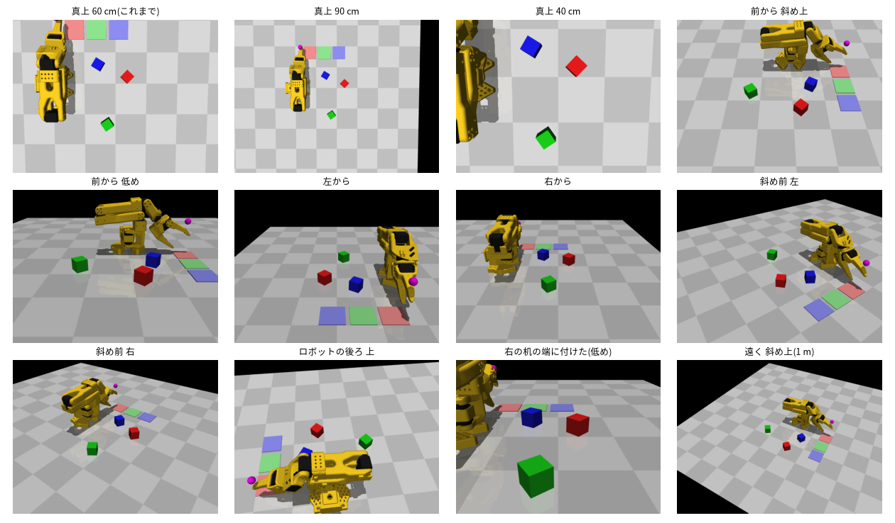
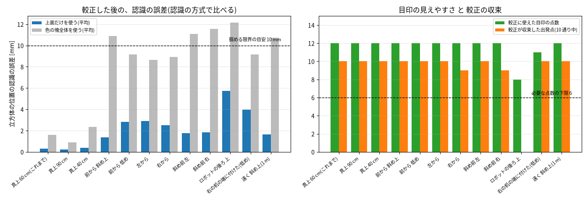

# カメラの置き場所の調査 ― 手の目印による較正は、任意の場所で有効か

2026-10-22。sim で、カメラを 12 通りの場所・向きに置いて、手の目印による較正と、立方体の認識が成り立つかを調べた。
(これまでは、真上 60 cm から真下を見る置き方だけだった。実機のウェブカメラは、置き方の自由度が大きいので、先に確かめた。)

| 見るもの | 場所 |
|---|---|
| 任意の位置・向きの投影と、較正(位置 3 + 向き 3 + 視野角 1) | `src/hand_sim/camera_pose.py` |
| 較正の観測(手の目印を撮る) | `src/hand_sim/sorting.py`(`collect_hand_marker_samples`) |
| 調査の実行(12 通りの置き場所) | `scripts/run_camera_placement_study.py` |
| 答え合わせ(画像なしの合成データ) | `scripts/check_camera_pose.py`(全 OK) |

## 結論
- **任意の置き場所で、較正は有効**(11 通り中 10 通り)。真上でなくても、前・横・斜め・低め・遠くから、認識の誤差が 4 mm 以内に収まった。
- ただし、**条件が 3 つある**:
  1. **手の目印が、カメラから見えること。** ロボットの後ろ側にカメラを置くと、目印が手の陰に隠れ、較正が成り立たなかった。
  2. **立方体の位置は、「色の塊の上面だけ」で出すこと。** 斜めから見ると、側面も写るので、塊全体の重心を使うと 9〜12 mm(最大 37 mm)ずれる。
  3. **較正の出発点を、複数試して、最も合う答えを採ること。** 出発点によっては、収束しない(右から、斜め前右で 9/10)。

## 1. 較正のモデルと、調べ方
- カメラの未知数は 7 つ: 位置 (x, y, z)、向き(回転ベクトル 3 つ)、視野角。レンズの歪みは入れていない。
- 観測は、これまでと同じ(`docs/sorting_trials.md` 5 章): 手(gripper)の目印を、16 か所に動かして撮る。目印の世界座標は、関節角から計算で分かる。
  目印が 6 点未満しか見えないときは、手を 150° 回した向きでも撮って足す。
- 出発点は、**目で見て決めた程度にずらした値**(位置 ±10 cm、向き ±10°、視野角 ±10°)を 10 通り。
- 較正の良さは、**「作業範囲の誤差」** で測る。立方体を置く範囲の格子点(18 点)が、本当のカメラで写る画素を、求めたカメラで世界座標に戻したときの誤差の平均。
  位置や向きの誤差そのものは、見ない。**位置と向きの誤差は、打ち消し合うことがある**(カメラを少しずらして、少し回すと、作業範囲では同じに見える)。
  実際、真上 60 cm の置き方で、位置の誤差は 5.7 mm あったが、作業範囲の誤差は 0.5 mm だった。
  「収束した」は、再投影誤差 2 画素未満 かつ 作業範囲の誤差 5 mm 未満。

## 2. 置き場所
カメラが見つめる点は、立方体を置く範囲の中心 (0.20, −0.04, 0.02) m。縦の視野角は 45°。
世界座標は、x = ロボットの前方、y = 左、z = 上。ロボットの土台は原点にある。

## 3. 結果
認識の誤差は、較正した結果で、立方体 45 個(15 配置 × 3 色)を認識した、本当の位置との差 [mm]。

| 置き場所 | 目印の点数 | 収束した出発点(10 通り中) | 作業範囲の誤差 | 認識の誤差(上面、平均 / 最大) | 認識の誤差(塊全体、平均 / 最大) | 判定 |
|---|---|---|---|---|---|---|
| 真上 60 cm(これまで) | 12 | 10 | 0.5 mm | 0.3 / 0.4 | 1.6 / 3.4 | 有効 |
| 真上 90 cm | 12 | 10 | 1.0 | 0.2 / 0.5 | 0.9 / 2.2 | 有効 |
| 真上 40 cm | 12 | 10 | 0.5 | 0.4 / 0.7 | 2.4 / 5.0 | 有効 |
| 前から 斜め上 | 12 | 10 | 1.8 | 1.4 / 1.8 | 10.9 / 12.6 | 有効(上面を使えば) |
| 前から 低め | 12 | 10 | 3.1 | 2.8 / 3.6 | 9.2 / 36.6 | 有効(上面を使えば) |
| 左から | 12 | 10 | 3.6 | 2.9 / 3.7 | 8.7 / 30.9 | 有効(上面を使えば) |
| 右から | 12 | **9** | 3.1 | 2.5 / 3.1 | 8.9 / 29.8 | 有効(複数の出発点を試す) |
| 斜め前 左 | 12 | 10 | 2.3 | 1.7 / 3.1 | 11.1 / 22.2 | 有効(上面を使えば) |
| 斜め前 右 | 12 | **9** | 2.5 | 1.8 / 2.3 | 11.6 / 21.0 | 有効(複数の出発点を試す) |
| 右の机の端に付けた(低め) | 11 | 10 | 3.4 | 3.9 / 5.3 | 9.2 / 36.7 | 有効(上面を使えば) |
| 遠く 斜め上(1 m) | 12 | 10 | 2.7 | 1.6 / 2.6 | 10.7 / 14.5 | 有効(上面を使えば) |
| **ロボットの後ろ 上** | **8**(150° 回した向きを足した) | **0** | 6.9 | 5.8 / 8.7 | 12.2 / 16.3 | **無効** |

## 4. 分かったこと

### (a) 較正は、置き場所によらず、成り立つ(目印が見えれば)
11 通りで、目印が 11〜12 点見えて、較正が、作業範囲の誤差 4 mm 以内に収束した。
カメラの向きを仮定せず(真下を向く前提を外して)、向きまで求めても、同じ手法で解ける。

### (b) 斜めのカメラでは、認識の方式が効く(較正とは別の問題)
真の較正(誤差なし)を使っても、**色の塊全体の重心**を使うと、斜めのカメラで 9〜14 mm ずれた(掴める限界の 10〜14 mm を超える)。
側面が写って、重心が、立方体の中心から手前へずれるため。**塊のうち、明るい画素(上面)だけ**の重心を、上面の高さに投影すると、1 mm 前後まで戻る。

- この方式は、「上面が側面より明るい」ことに頼っている。sim は、真上からの照明で、上面が最も明るい。実機の照明の向き(机の上のライトの位置)によっては、成り立たない。
- 上面を、色の明るさでなく、**形**(四角形の輪郭を探す)で取る方法もある。実機で必要になったら考える。

### (c) 目印が見えない側には、置けない
ロボットの後ろにカメラを置くと、手を真下に向けた姿勢で、目印が手や腕の陰に隠れた(16 点中 0 点)。
手の向きを 150° 回して足すと 8 点見えたが、較正は収束しなかった(作業範囲の誤差 6.9 mm)。
手の目印は、手の片側(指の開閉の向きの +側)に付けてあるので、**目印の側から見る**必要がある。

対策の案: 目印を、手の上に、棒の先に付けて高くする(どちらから見ても、見える)。または、目印を 2 か所(両側)に付ける。

### (d) 位置・向きの誤差ではなく、「作業範囲の誤差」を見る
個別に見ると、位置の誤差が 5〜7 mm、向きの誤差が 0.2° になる置き方でも、作業範囲の誤差は 0.5〜3.6 mm と小さい。
「カメラの位置・向きを、正確に求めること」が目的ではなく、「立方体の座標を正しく出すこと」が目的なので、後者で評価する。

### (e) 出発点の影響
10 通りの出発点で、右から・斜め前右は、1 通りが収束しなかった(局所解)。再投影誤差が最も小さい答えを採れば、全部が正しい答えになった。
**実機では、出発点を複数(位置・向きを変えて 10 通り程度)試して、最も合うものを採る**のがよい。

## 5. 実機のウェブカメラへの示唆
購入したカメラ: TUNSONE A03(1080p、USB。Amazon のページ B0BKTJ9X2H)。**視野角とレンズの歪みは、仕様に書かれていない。**
- 視野角は、較正で求める(7 つの未知数の 1 つ)。ただし、カメラが遠いと、「距離」と「視野角」が見分けにくく、出発点によっては収束しにくい(真上 90 cm、遠く 1 m)。
  **視野角は、先にチェスボードで求めて固定する**(内部パラメータの較正)と、安定する。`calibrate_camera_pose(..., fix_fovy=True)` が、視野角を固定して解く。
- レンズの歪みは、今の sim に入っていない。**1080p の安価なウェブカメラは、画像の端が歪むことが多い**ので、チェスボードで先に歪みを求めて、補正した画像で、この較正を行う必要がある。
  (OpenCV の `calibrateCamera` が定番。今の `.venv` には入っていない。入れるか、自分で書くかを、そのときに決める。)
- 置き場所は、**真上〜前の斜め上、高さ 40〜90 cm**が、最も誤差が小さかった(0.2〜3 mm)。机の端の低い位置(15 cm)や、横からも、4 mm 以内で成り立った。
  ロボットの後ろには置かない。
- 手の目印は、**カメラの側から見える位置**に付ける。

## 6. 示さないこと
- **画素のノイズ、目印の位置の測り間違い、レンズの歪みは、この調査に入れていない。** 真上のカメラでの調査(`docs/sorting_trials.md` 5 章)では、目印の位置の誤差が 1 対 1 で効いた。斜めのカメラでも、同じ限界(実機の腕の精度 ±0.7 cm)がある。
- 立方体の向き(yaw)は、この調査では出していない(斜めからは、上面の四角形のゆがみを直す必要がある)。位置だけを調べた。
- sim の照明は理想的(上面が最も明るい)。実機の照明では、結果が変わる。
- 較正の出発点を「目で見て決めた程度」(位置 ±10 cm、向き ±10°)にした。もっとずれていると、収束しないことがある。

## 7. 次にやること
- 実機のウェブカメラを接続して、置き場所を決める(真上〜前の斜め上、高さ 40〜90 cm)。
- チェスボードで、視野角とレンズの歪みを求める。
- 上の較正の手順を、実機で行う(目印を手に付ける。机の目印との併用も検討)。
- 斜めのカメラでの、立方体の向き(yaw)の出し方を足す(必要になったら)。
