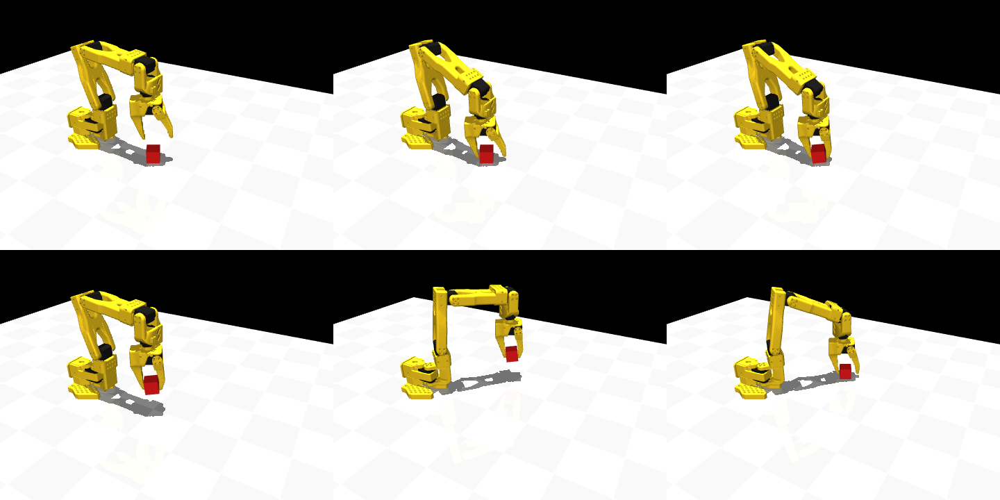

# sim で掴む(新計画の工程2)― 考え方と、つまずいた点

SO-101 で立方体(一辺 3 cm、20 g)を、**真上から掴んで、持ち上げて、別の場所へ置く**動作を sim で作った。
コードは `src/hand_sim/so101_grasp.py`(動作)と `so101_ik.py` の `solve_ik_pose`(向きまで合わせる IK)。
答え合わせは `scripts/check_so101_grasp.py`(36 件、全 OK)。画像は `scripts/render_grasp_sequence.py` で作る。

左上から、①立方体の真上 ②降下(指は開いたまま)③指を閉じた ④持ち上げた ⑤置き場の真上へ運んだ ⑥置いて指を開いた。

## 1. 動作の流れ(状態機械)

| 段階 | 腕 | 指 | 時間 | 関数 |
|---|---|---|---|---|
| 真上へ | `above`(掴む位置の 5 cm 上) | 開く(0.5 rad) | 3.0 秒 | `move_to` |
| 降下 | `grasp` | 開いたまま | 1.5 秒 | `move_to` |
| 閉じる | `grasp` のまま | 閉じる | 1.0 秒 | `move_to` |
| 持ち上げる | `above` | 閉じたまま | 1.5 秒 | `move_to` |
| 運ぶ | `place_above` | 閉じたまま | 2.0 秒 | `move_to` |
| 降下 | `place`(3 mm 浮かせる) | 閉じたまま | 1.5 秒 | `move_to` |
| 放す | `place` のまま | 開く | 1.0 秒 | `move_to` |
| 上がる | `place_above` | 開いたまま | 1.5 秒 | `move_to` |

姿勢(`above`、`grasp`、`place_above`、`place`)の関節角は、動かす前に IK で全部求めておく(`plan_pick_place`)。
`move_to` は、今の目標から次の目標まで、`ctrl` を S 字の曲線でなめらかに変える。いきなり目標を入れると、PD 制御が最大の力で飛びついて暴れる。

## 2. 手先の向きまで決める IK

前の IK(`solve_ik`)は、手先の**位置**だけを合わせた。掴むには、次も要る。
- 指の先を**真下**に向ける(横から掴むと、立方体を机に押しつけられない)。
- 指が開閉する向きを**机と平行**にする(立方体を左右から挟む)。

`gripperframe`(固定側の指の先)の座標軸は、x = 指の先へ向かう向き、z = 指が開閉する向き。掴むときの向きは、
**x = 真下 (0, 0, −1)、z = 机と平行で、世界の x 軸から yaw だけ回した向き**(`grasp_rotation`)。

`solve_ik_pose` は、誤差を「位置 3 つ + 向き 3 つ」の 6 つにして、`solve_ik` と同じ減衰付き最小二乗法で解く。
関節は 5 つしかないが、「真下を向く(2 自由度)」と「机と平行に回す(1 自由度 = wrist_roll)」は、この腕で作れる向きなので、解ける。

| 向きの誤差 | 式 |
|---|---|
| 今の各軸と目標の各軸の外積の和 | `0.5 * Σ cross(R[:, i], 目標R[:, i])` |

向きがそろっていると 0 になる。外積は「今の向きを、目標へ回す回転軸 × 角度」の近似になる。

### 立方体の向き(yaw)と指の向き
立方体が机の上で回っているとき、指の開閉の向きを**立方体の面に垂直**にしないと、角(かど)に当たって回ってしまう。
立方体は 90° ごとに同じ形なので、候補は `cube_yaw + 90° × k`(`plan_for_cube`)。yaw が 0 に近い順に、IK が解ける最初のものを使う。

### 掴む位置
`CUBE_IN_SITE = (−0.005, 0, 0.017)`: 立方体の中心が、gripperframe から見てどこにあるか。
- x = −0.005: 指の先より 5 mm 手前。これより先まで入れると、指の先が机にぶつかる。
- z = +0.017: 固定側の指の内側の面から、立方体を入れるのに十分な余裕を持たせた位置。閉じると、立方体は固定側へ押されて約 +0.011 に落ち着く。

`HOVER`(真上へ上がる高さ)は 5 cm。8 cm にすると、手首(wrist_flex)が可動域の端(95°)に届いて、IK が解けなくなった。

## 3. つまずいた 2 点(sim 固有。実機にはない)

### (a) 指の当たり判定が「凸包」で、すき間が埋まっていた
MuJoCo は、メッシュどうしの接触を**凸包**(でこぼこを埋めて、出っ張りを結んだ形)で判定する。
固定側の指は、手のひらと指の先がつながった 1 つのメッシュなので、凸包にすると、すき間が埋まる。
掴む位置で、凸包が立方体に **7.6 mm めり込んで**、降りる途中で立方体を押しのけた。

直し方(`load_grasp_model`): 元の指の当たり判定を切り、**指の先の細い板(ブレード)の頂点だけ**から、新しい当たり判定を作って足す。
板はほぼ凸なので、凸包にしても形が変わらない。見た目のメッシュは、そのまま。

実測した指の形: 固定側も動く側も、先に近い所は幅 1 cm 以下の細い板(ピンセットのような形)。
隙間は、動く側の関節(ちょうつがい)から遠いほど広い。開いた角度 0.5 rad で、指の先の隙間は約 55 mm。

### (b) 指の力が強すぎて、立方体が深くめり込んだ
元のモデルの gripper のトルク上限は 3.35 N·m で、指を閉じる目標(−0.1 rad)まで、強く押し続ける。
MuJoCo の接触は柔らかく、軽い物体(20 g)との接触は、さらに柔らかくなる。結果、指が立方体に深さ **11 mm** もめり込んで、
立方体が指の先の方へ押し出され、掴めなかった(閉じたあとの接触力は片側 9〜12 N で、押す力に負けていた)。

直し方:
- gripper のトルク上限を **0.3 N·m** に下げる(`GRIP_TORQUE_MAX`)。
- 接触の時定数(`solref`)を 0.02 → 0.004 秒にして、硬くする(`CONTACT_TIMECONST`。時間刻み 0.002 秒の 2 倍が下限)。

直したあと(閉じた状態を測った値): 指は 0.197 rad で立方体に当たって止まり、挟む力は片側 約 6 N(持ち上げ中は約 5 N)、めり込みは 0.2 mm 以下。
立方体の重さ(0.2 N)は、摩擦(係数 1.0)で十分に支えられる。

## 4. 結果と、この結果が示さないこと

`check_so101_grasp.py`: 立方体の位置 6 か所(x = 0.15、0.22 m、y = −0.10、0、+0.08 m)× 向き 6 通り(0〜135°)の 36 件で、全部成功。
置いた位置の誤差は 0.3〜0.7 mm。届かない位置(0.45 m、0.02 m)は IK が解けず、`ValueError` になる。

示さないこと:
- **立方体の位置は、sim の正解をそのまま使っている。** 実際は、カメラで見つけた位置(誤差あり)になる。工程3 以降。
- **摩擦、挟む力は、仮の値**(摩擦 1.0、約 6 N)。実機の指(3D プリントの樹脂)の摩擦は測っていない。工程4・5 の実機で確かめる。
- **失敗が 0 件なので、失敗の分類はまだできない。** 工程3 で、位置のばらつき(認識の誤差)、摩擦、立方体の向きを変えて、失敗する条件を探す。
- 実機で動かすときは、`sim_to_real`(オフセット込み)で関節角を実機の値にする。指の挟む力は、実機のサーボの設定で決まる。

## 5. 実機への橋渡し
`plan_for_cube` が返す姿勢は、sim の関節角 [rad] の 5 つ。実機に送るときは、`sim_to_real(model, np.append(q, 指の値))`
(`docs/sim_real_mapping.md`、`docs/offset_calibration.md`)で、実機の値(度、オフセットを引いた値)にする。
sim の wrist_flex の可動域(±95°)は、実機(±112°)より狭いので、sim で解けた姿勢は、実機でも可動域に入る。
