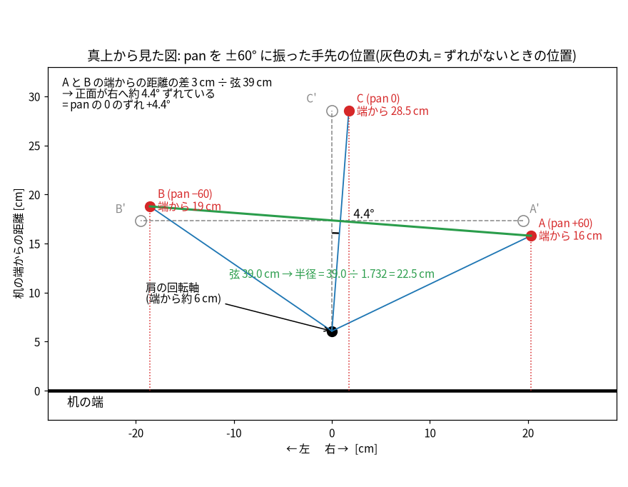
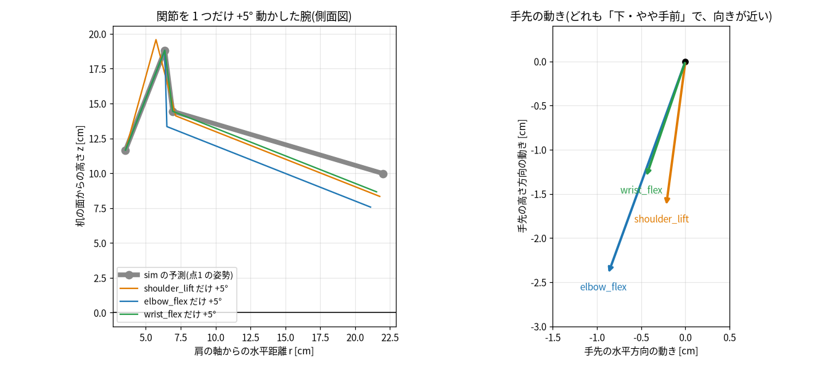
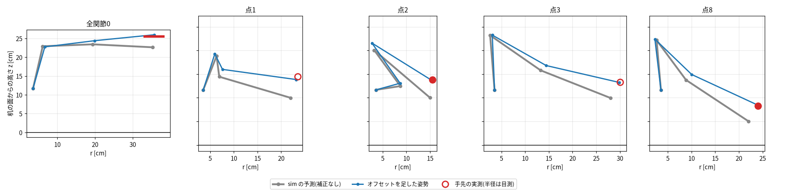
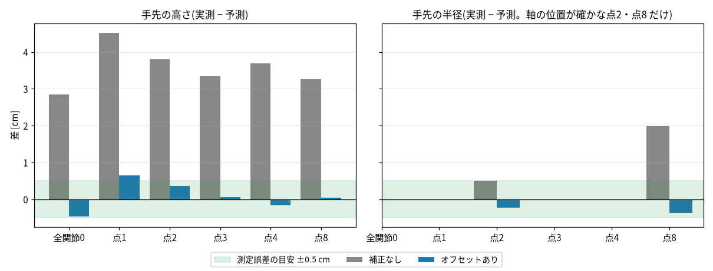
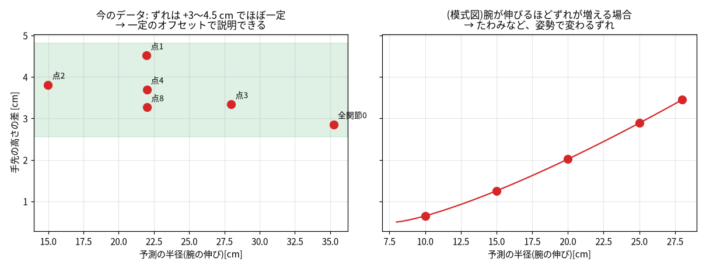

# sim と実機の姿勢のずれ(オフセット)の測り方と使い方

2026-10-21 に、実機の手先位置を測って求めた「関節ごとの角度のずれ」を、どう測り、どう計算し、どこまで信じてよいかをまとめる。
結果は `src/hand_sim/sim_real.py` の `OFFSET_DEG` に入れてある。

## 1. オフセットとは

**実機に送った角度と、実機の腕が本当に取っている角度との、姿勢に関係なく一定のずれ [度]のこと。**

```
sim の角度 = 実機に送った値 + オフセット
```

例: elbow_flex のオフセットが −7.8° なら、実機に 87.0° と指令しても、腕は sim の「87.0° − 7.8° = 79.2°」の形になる。

原因の候補は、キャリブレーションで中点を手で合わせたときの数度のずれ、サーボのホーンのかみ合わせ(1 歯ぶんで約 5°)など。
部品の寸法のずれ(STL)は、図面と STL の実寸が一致したので原因ではない(2026-10-21 に確認)。


| 関節                   | オフセット     | 幅の目安  | 求め方                  |
| -------------------- | --------- | ----- | -------------------- |
| shoulder_pan(Z 軸まわり) | **+4.4°** | ±1°   | 2 章                  |
| shoulder_lift        | +3.0°     | ±1〜2° | 3 章                  |
| elbow_flex           | −7.8°     | ±2〜3° | 3 章                  |
| wrist_flex           | −3.7°     | ±3〜4° | 3 章                  |
| wrist_roll、gripper   | 0         | 未測定   | 手先の位置にほとんど効かないので今は 0 |


## 2. shoulder_pan(Z 軸まわり)のオフセット

pan は、肩の軸のまわりに腕全体を横へ回す関節(真上から見て回る)。測るのは、**真上から見た手先の位置**。

### 手順

1. ロボットの土台の側面 1 を、机の端にぴったり合わせて置く。反対側の側面 2 までの距離(土台の厚み)を、中心から対称な 2 か所で測り、どちらも 8.7 cm で等しい → 2 つの側面は平行で、土台がゆがんで置かれていない。
2. 腕の形は同じまま、pan だけを **+60°、−60°、0°** にして、手先(固定側の指の先端)の真下に印をつける(下げ振りを使う)。それぞれ A、B、C とする。
3. 次の 4 つを測る: ① 印 A と B の間の距離(弦)、② A・B・C から机の端までの距離。



### 2 つの量を、別々に求める


| 求めたいもの                   | 測るもの               | 計算                               | 結果                         |
| ------------------------ | ------------------ | -------------------------------- | -------------------------- |
| **半径 r**(肩の軸から手先までの水平距離) | 弦 A–B              | r = 弦 ÷ (2 × sin60°) = 弦 ÷ 1.732 | 39.0 ÷ 1.732 = **22.5 cm** |
| **pan のオフセット**           | A と B の、机の端からの距離の差 | 角度 = sin⁻¹(差 ÷ 弦)                | sin⁻¹(3 ÷ 39) = **約 4.4°** |


- **弦は「半径」を出すために使う。** 肩の軸の位置を目で測らなくてよいのが利点(目測だと約 1 cm 狂った)。
- **pan のオフセットは、A と B の端からの距離の差から出す。** pan が正しく 0 なら、左右対称に振った A と B は、端から同じ距離になる。3 cm 違うのは、正面が傾いているから。
- A・B・C の位置はすべて同じ向きに回るだけなので、**CA = CB は、ずれがあっても成り立つ**。「CA と CB が等しいか」では、pan のずれは分からない(CA = CB ≈ 22.5 cm は、半径が 22.5 cm という確認にはなった)。
- 土台の側面 1 が机の端にぴったり合っていることが、前提になる。合っていなければ、距離の差は、土台の傾きと pan のずれの合計になり、分けられない(4.4° の傾きなら、長さ 10 cm の側面で約 8 mm のすき間が見える)。
- 向き: 実機の pan は + が右。A(+60°)の方が端に近かったので、正面は右へずれている。つまり **オフセットは +4.4°**(指令 0 の腕は右へ 4.4° 向く。正面に向けたいときは、指令に −4.4° を足す)。


### 半径と高さには影響しない

pan は腕を横へ回すだけなので、手先の高さと「肩の軸からの水平距離」は変わらない。
だから、3 章のオフセット(lift・elbow・wrist)の測定は、pan のずれと別に求められる。

## 3. shoulder_lift、elbow_flex、wrist_flex のオフセット

この 3 つは、腕を縦(前後と上下)に曲げる関節。測るのは、**手先と軸の高さ、手先の半径**。

### 3-1. 何を測ったか


| 測ったもの                         | 姿勢                    | 値                                   |
| ----------------------------- | --------------------- | ----------------------------------- |
| 全関節 0 の、肘の軸・手首の軸・手先の高さ(机の面から) | `--pose 0 0 0 0 0 10` | 23.0、24.3、25.5 cm                   |
| 手先の高さ、半径                      | 点1(r=22、z=10)         | 14.5 cm、23.5 cm(半径は目測)              |
| 同上                            | 点2(r=15、z=10)         | 13.8 cm、15.5 cm(机の端から 21.5 − 軸 6.0) |
| 同上                            | 点3(r=28、z=10)         | 13.3 cm、30.0 cm(半径は目測)              |
| 同上                            | 点4(r=22、向き −60°、z=10) | 13.7 cm、24.0 cm(半径は目測)              |
| 同上                            | 点8(r=22、z=5)          | 8.3 cm、24.0 cm(机の端から 30.0 − 軸 6.0)  |
| 弦(pan ±60°。点1 の腕の形)           | 2 章                   | 39.0 cm                             |


「点N」は `docs/hand_position_measurement.md` の測定点で、sim が手先をこの位置に置く指令を、**補正なしのまま**実機へ送って測った。
測るのは、固定側の指の先端(sim の `gripperframe`)。机の面から高さを測る。

### 3-2. どう計算したか(最小二乗法)

1. 3 つのオフセット(lift、elbow、wrist)を仮に決める。
2. 各測定の指令に、仮のオフセットを足した姿勢を sim で作り、手先の高さ・半径・弦の「予測」を出す。
3. 予測と実測の差(高さ・半径・弦)を、全部まとめて二乗した合計が最小になるオフセットを探す(ガウス・ニュートン法。`scripts/fit_joint_offsets.py`)。

測定が 1 つでも変われば、オフセットも変わる。測定の式は 14 本で、求めるのは 3 つ。

### 3-3. 関節ごとのオフセットは、手先をどう動かすか

関節を 1 つだけ +5° 動かしたときの、手先の動き(点1 の姿勢):




| 関節を +5°       | 手先の水平方向 | 手先の高さ   |
| ------------- | ------- | ------- |
| shoulder_lift | −0.2 cm | −1.6 cm |
| elbow_flex    | −0.9 cm | −2.4 cm |
| wrist_flex    | −0.4 cm | −1.3 cm |


**3 つとも、手先を「下・やや手前」へ動かす向きが近い。** そのため、手先の位置だけからでは、3 つの配分が決まりにくい(どれかを増やして、別のを減らしても、手先はほぼ同じ場所に来る)。
データの選び方で、値が動く理由はこれ。実際に、使うデータで次のように動いた:


| データ            | shoulder_lift | elbow_flex | wrist_flex |
| -------------- | ------------- | ---------- | ---------- |
| 半径も使う(式 14 本)  | +3.0°         | −7.8°      | −3.7°      |
| 半径を使わない(式 9 本) | +1.8°         | −4.7°      | −7.8°      |


目測の半径は約 1 cm の誤差を含むので、**今の値(上の行)は暫定**。ただし、どちらの値でも、測った姿勢の手先の高さは ±0.7 cm 以内で合う。

### 3-4. 結果(測った姿勢で、補正前後の差)


| 姿勢    | 手先の高さ [cm]: 予測 → 補正後 / 実測 | 半径 [cm]: 予測 → 補正後 / 実測 |
| ----- | ------------------------- | ---------------------- |
| 全関節 0 | 22.6 → 26.0 / 25.5        | 35.3 → 35.7 / (未測定)    |
| 点1    | 10.0 → 13.8 / 14.5        | 22.0 → 23.2 / 23.5(目測) |
| 点2    | 10.0 → 13.4 / 13.8        | 15.0 → 15.7 / 15.5     |
| 点3    | 10.0 → 13.2 / 13.3        | 28.0 → 29.9 / 30.0(目測) |
| 点4    | 10.0 → 13.9 / 13.7        | 22.0 → 23.2 / 24.0(目測) |
| 点8    | 5.0 → 8.3 / 8.3           | 22.0 → 24.4 / 24.0     |






灰色の棒(補正なし)は +3〜4.5 cm ずれていたが、青い棒(オフセットあり)は、測定の誤差(±0.5 cm)に近い範囲に収まった。

## 4. 一定のオフセットで足りるか、足りないかの判断

オフセットは「姿勢に関係なく一定」と仮定している。実機には、姿勢で変わるずれ(重力によるたわみ、ギアのガタなど)もありうる。次の 3 つで判断する。


| 判断の材料        | 一定のオフセットで足りる                                              | 足りない         |
| ------------ | --------------------------------------------------------- | ------------ |
| ① 補正前のずれの大きさ | 姿勢が変わっても、ほぼ同じ(今: 高さ +2.9〜4.5 cm)                          | 腕を伸ばす姿勢ほど増える |
| ② 補正後の残り     | どの姿勢でも測定誤差(±0.5 cm)の範囲                                    | 特定の姿勢だけ大きく残る |
| ③ 測る前に出した予測  | 当たる(点2・点8 の高さは、測る前の予測 13.2〜13.8、8.2〜8.3 に対して、実測 13.8、8.3) | 外れる          |




**今の判定: 一定のオフセットで足りる。** ① 高さのずれは、腕の伸びによらずほぼ一定(2.9〜4.5 cm)。② 補正後の高さの差は、最大 0.7 cm。③ 点2・点8 は、測る前に出した予測の範囲に収まった。

### 足りない場合の対処

- **一定ではないずれが分かった姿勢の周りだけ、点を足して測り直す。** 測った点を `MEASURED` に足して、オフセットを求め直す(5 章)。
- 腕を伸ばす姿勢でだけ高さが増えるなら、**たわみを足す**: たわみは、腕の重さによるトルク(関節から先の重心までの水平距離)におおよそ比例するので、「オフセット + 係数 × cos(その先のリンクの傾き)」のような形で、補正を姿勢に依存させる案がある(実際に必要になってから、データを見て決める)。
- 実機で最終的に手先を合わせる部分は、**カメラで見て直す(closed-loop の視覚サーボ)**。第2週で作ったものが、数 cm 程度の一定でないずれを打ち消す(`docs/visual_servo.md`)。オフセットは、その前の「最初のねらい」を近づけるためのもの。


## 5. 使い方と、測り直すとき


### 反映の場所

`src/hand_sim/sim_real.py` の `OFFSET_DEG`。変換の両方向に効く。


| 関数            | 式                                        |
| ------------- | ---------------------------------------- |
| `sim_to_real` | 実機の値 = sim の角度 − オフセット(実機に送る指令を作る)       |
| `real_to_sim` | sim の角度 = 実機の値 + オフセット(実機の腕の姿勢を sim に出す) |


- `apply_offset=False` を付けると、オフセットを使わない。`scripts/fit_joint_offsets.py` は、測定時に実機へ送った素の指令から求めるので、これを使う。
- `plan_hover_pose.py`、`plan_measure_points.py` が出す実機への指令は、オフセットを引いた値になる(`docs/hand_position_measurement.md` の指令は、反映の前に作ったもので、**補正なし**)。
- 補正後の指令が、実機の可動域の端 3° 以内に入ると、`real_send_pose.py` が拒否する。点2 は、補正すると shoulder_lift が −103° で、ぎりぎり。


### 測り直す手順

1. 実機に、補正なしの指令を送って、手先の高さと半径(または、机の端からの距離)を測る。
2. `scripts/fit_joint_offsets.py` の `MEASURED` に、指令と測った値を足す。肩の軸が机の端から 6.0 cm なので、半径 = 端からの距離 − 6.0。
3. `.venv/bin/python scripts/fit_joint_offsets.py` を実行し、結果を `OFFSET_DEG` に写す。`--no-radius` で、半径を使わない当てはめもできる。
4. `.venv/bin/python scripts/check_sim_real.py`(全 OK)と、`.venv/bin/python scripts/make_offset_figures.py`(この文書の図を作り直す)を実行する。


## 6. 残っていること、注意

- 3 つの関節(lift、elbow、wrist)の配分は、まだ曖昧(3-3)。測っていない姿勢で、数 mm〜1 cm の外れが出うる。
- 半径の目測(点1・点3・点4)は、約 1 cm の誤差を含む(肩の軸の位置を目で測ったため)。点2・点8 は、机の端からの距離なので、より確か。
- 水平器(スマホ)で測ったリンクの傾きは、リンクの凹凸のため、当てはめに使っていない。当てはめは「手の向きが sim より −8〜−11° 傾く」と言うが、水平器は「全関節 0 で手 1° 以内」だった。この食い違いは、水平器の読みが当てにならないとして、今は保留している。
- 肩の軸は、土台の側面 1(= 机の端)から 6.0 cm(C の 28.5 − 半径 22.5)で、土台の厚み 8.7 cm の内側に収まっていて、前に測った「土台の後端から軸まで約 6 cm」と合う。sim のモデルでは、この距離が約 7.0 cm で、1 cm 違う(オフセットには影響しない。土台と机の位置関係を sim に入れるときに使う)。
- wrist_roll と、手先が掴む位置(指の先端)の確認は、掴む動作に進んだときに行う。


## 6. カメラの画像で求め直したオフセット(2026-10-24 夜)

定規で測った OFFSET_DEG(1〜5 章)を、カメラの画像で確かめ、求め直した。手に付けた ArUco の板(ID 0)の姿勢と、机に固定した板(ID 1〜6)でカメラの位置を求め、手先(gripperframe)の世界座標での位置・向きを出し、実機の関節角から sim で計算した値と比べた。
手順: `scripts/real_pan_sweep.py --tag <名前> --pose <lift> <elbow> <wrist_flex> --deltas 0 30 60`(形まで自動で動かし、pan を 0°、30°、60° に振って、各位置で、関節角の読み取りと撮影)→ `scripts/fit_real_offsets.py`。

| 関節 | 旧(定規) | 新(カメラ) | ± (1σ) |
|---|---|---|---|
| shoulder_pan | +4.4 | +4.4(変更なし) | - |
| shoulder_lift | +3.0 | **+2.7** | 1.0 |
| elbow_flex | −7.8 | **−6.5** | 1.4 |
| wrist_flex | −3.7 | **−6.0** | 1.0 |
| wrist_roll | 0.0(未測定) | **+5.7** | 1.1 |

- 使った形: 手を真下に向けた 4 つ(B: 半径 184 mm、H1: 146 mm、H2: 〜220 mm、H3: 〜260 mm。高さ 30〜70 mm)。使う作業(掴む)の形と同じ。
- **検証**: B と H1 だけで求めた補正を、使っていない H2・H3 に当てると、手先の位置の差が 4〜7 mm → 1〜4 mm、向きの差が 5〜8° → 1〜3° に縮んだ。新しい値でフィットし直すと、補正量は ±0.04° で 0。
- 新しい値での、手を真下の 12 サンプルの、画像 − sim: 位置 0.2〜3.4 mm(最大 5.7 mm)、向き 0.1〜4.1°。
- **限界**: (1) 腕を前上がり(A)や水平に 43 cm 伸ばした形(D)では、位置の差が 12〜15 mm 残る(別の要因。使う形から外れている)。(2) lift と elbow は、この形だけでは分けにくく、組み合わせとして効く(±1.4° 以内)。
  (3) wrist_roll の +5.7° は、関節のずれと、手の板の取り付けの回り(−6.8°)の、どちらとも解釈できる(当てはまりはほぼ同じ)。位置(手先)にはほとんど効かない。
- 板の補正(dx +0.7 ± 2.2、dy +3.8 ± 2.0 mm、向き −0.8° ± 0.6)は、誤差の範囲に近いので、反映していない。
- 前提の訂正: sim の世界座標の原点は、肩の軸の真下ではなく、肩の軸の 38.8 mm 後ろ(`fixed_board.SHOULDER_AXIS_X_SIM_M`)。
