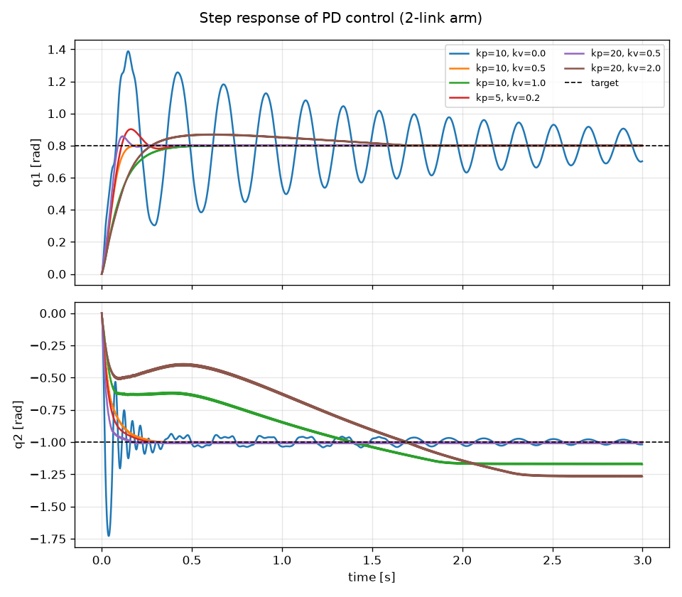

# PD制御のステップ応答(2リンクアーム)

`scripts/step_response.py` の結果。目標角 (q1, q2) = (0.8, −1.0) rad を、出発点 (0, 0) から一気に切り替えて 3 秒間動かした。
関節の粘性は `damping=0.01`(`models/arm2link.xml`)。整定は「目標との差が、出発点から目標までの距離の 2% 以内に入りっぱなし」になる時刻。

| kp | kv | q1 行き過ぎ [rad] | q1 整定 [s] | q2 行き過ぎ [rad] | q2 整定 [s] |
|---:|---:|---:|---:|---:|---:|
| 10 | 0.0 | 0.588 | なし | 0.728 | 2.80 |
| 10 | 0.5 | 0.002 | 0.14 | 0.009 | 0.25 |
| 10 | 1.0 | 0.001 | 0.38 | 0.172 | なし |
| 5 | 0.2 | 0.102 | 0.34 | 0.003 | 0.21 |
| 20 | 0.5 | 0.058 | 0.16 | 0.008 | 0.14 |
| 20 | 2.0 | 0.070 | 1.51 | 0.267 | なし |

## 分かったこと
- **P だけ(kv=0)は振動し続ける**: q1 は 3 秒たっても整定しない。バネだけでブレーキがないため。
- **D(kv)を足すと落ち着く**: kp=10, kv=0.5 で行き過ぎがほぼ 0、0.25 秒以内に整定した。
- **kv は大きければよいわけではない**: kv=1.0 と 2.0 では、軽いリンク2(慣性 約 0.0008 kg·m²)が目標に届かず、
  −0.5 付近で止まったあとゆっくり動き、最後は目標とずれた値(−1.17、−1.26)で止まった。
  原因は、速度に比例するブレーキを 1 ステップ(0.002 秒)ごとの陽的な計算で出していること、
  トルク上限(±2 N·m)で頭打ちになることが重なったためと考えている(要検証)。
- 採用するゲインの暫定値: kp=10, kv=0.5(`scripts/view_arm.py`)。

## 次にやること
- 上の「原因」の検証(ステップ幅 `timestep` を変える、トルク上限を外す、など)。
- 実機のサーボとの差を測るときの比較の基準として、このログ(`outputs/step_response_*.csv`)を使う。
