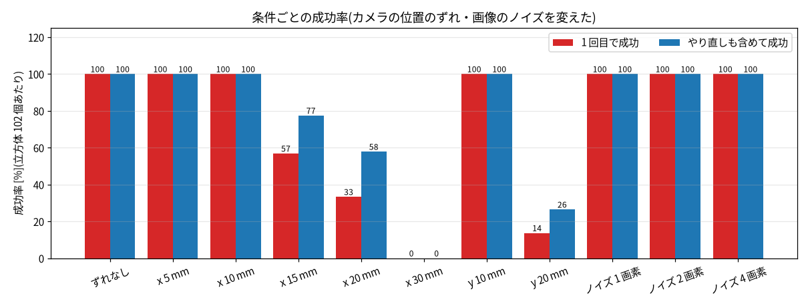
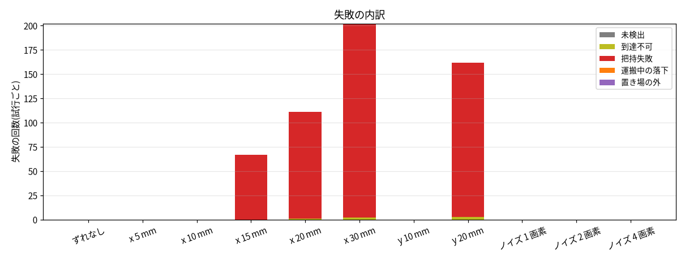
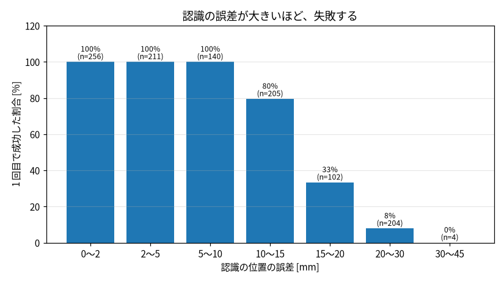

# sim での仕分けの試験(新計画の工程3)― 構成、結果、失敗の分析

机の上にランダムに置いた 3 色(赤・緑・青)の立方体を、真上のカメラで見つけて、色ごとの置き場へ運ぶ。
これを 102 個ぶん(34 エピソード)繰り返して、成功率と失敗の内訳を出した。さらに、**カメラの位置のずれと画像のノイズを変えて、失敗が出る条件を探した。**

| 見るもの | 場所 |
|---|---|
| シーン(立方体 3 色、置き場 3 つ、固定カメラ) | `models/so101/scene_sort.xml` |
| 色の見分け、位置・向きの検出 | `src/hand_sim/vision.py`(`find_cube_pose` など) |
| 仕分けの流れ、結果の分類 | `src/hand_sim/sorting.py` |
| 試験の実行(条件を指定、CSV 出力、集計) | `scripts/run_sorting_trials.py` |
| 答え合わせ | `scripts/check_sorting.py`(全 OK) |
| 図の作成 | `scripts/make_sorting_figures.py` |

## 1. 試験の構成

### シーン
- 立方体: 一辺 3 cm、20 g。赤・緑・青の 3 個。位置と向きは、試験のたびにランダム(下の範囲)。
- 置き場: 一辺 6 cm の薄い板。赤 (0.07, 0.17)、緑 (0.14, 0.17)、青 (0.21, 0.17) m。**板は薄い色にして**、色検出が立方体と取り違えないようにしてある。
- カメラ: 床の上 0.6 m から真下を見る固定カメラ(eye-to-hand)。画像は 640 × 480。
- 立方体の範囲: x = 0.14〜0.26 m、y = −0.14〜+0.06 m、土台から 0.27 m 以内。立方体どうしは 6 cm 以上離す。向きは 0〜90°。

### 1 個ぶんの流れ(`run_attempt`)
1. 腕を待機の姿勢へ戻す(腕をたたんで、左へ回して、視野の外へ)。立方体を隠さないため。
2. 撮影して、3 色の立方体の位置と向きを出す。
3. 見つけた位置へ、掴んで運ぶ(`pick_and_place`。`docs/grasp_basics.md`)。
4. 結果を分類する。成功でなければ、**もう 1 回だけやり直す**(撮り直して、同じ流れ)。

### 位置と向きの出し方
- 色: 「その色のチャンネルが大きく(100 超)、他の 2 つが 0.4 倍未満」の画素(`color_mask`)。一番大きな塊だけを使う。
- 位置: 塊を囲む四角形の中心(画素)を、`pixel_to_world` で、立方体の上面の高さ(3 cm)の世界座標に直す。
- 向き: 塊の画素を、角度 θ だけ回した軸に投影し、軸にそろった長方形の面積が最小になる θ(0〜90° を 1° ずつ)。正方形は辺がそろうとき、外接長方形が最小になる(`estimate_square_yaw`)。
- ずれなしで、位置の誤差は平均 0.8 mm、最大 1.4 mm。向きの誤差は平均 0.3°、最大 1.7°(60 個)。

### 成功と、失敗の種類
成功 = 立方体の中心が、自分の色の置き場の板の中に入った(中心が板の中心から ±3 cm 以内で、机の上にある)。

| 失敗の種類 | 判定 |
|---|---|
| 未検出 | カメラで、その色が見つからなかった |
| 到達不可 | 腕が届かない位置で、IK が解けなかった |
| 把持失敗 | 持ち上げても、立方体の高さが 5 cm に届かなかった(掴めていない) |
| 運搬中の落下 | 持ち上げたが、置き場の上で、立方体が手の中にいなかった |
| 置き場の外 | 置いたが、板の中に入らなかった |

加えて、**他の立方体を 5 mm 以上動かしたか**(`moved_others_mm`)と、所要時間(sim の時間)を記録する。

## 2. 結果

### ずれなしの基本条件(102 個)
**1 回目で 102 / 102 = 100%**。失敗は 0 件。所要時間は 1 個あたり 15.0 秒(sim の時間)。他の立方体は動かさなかった。

ただし、これは**理想の条件**(カメラの位置が正確、光も一定、物体は同じ摩擦で同じ重さ)の成績で、実機の見込みではない。

### 条件を変えた結果
カメラの位置を「ずれたまま信じる」(実機では、カメラの位置を測って求めるので、必ずずれる)、画素位置に乱数のノイズを足す、の 2 通り。
x は画像の右(世界の +x)、y は画像の上(世界の +y)方向のずれ。

| 条件 | 認識の誤差(平均) | 1 回目で成功 | やり直しも含めて成功 | 主な失敗 |
|---|---|---|---|---|
| ずれなし | 0.8 mm | **100%** | 100% | なし |
| x に 5 mm | 4.6 mm | 100% | 100% | なし |
| x に 10 mm | 9.5 mm | 100% | 100% | なし |
| y に 10 mm | 10.6 mm | 100% | 100% | なし |
| **x に 15 mm** | 14.5 mm | **57%** | 77% | 把持失敗 67 回 |
| **x に 20 mm** | 19.5 mm | **33%** | 58% | 把持失敗 110 回、到達不可 1 回 |
| x に 30 mm | 29.5 mm | 0% | 0% | 把持失敗 200 回、到達不可 2 回 |
| **y に 20 mm** | 20.5 mm | **14%** | 27% | 把持失敗 159 回、到達不可 3 回 |
| ノイズ 1 画素 | 1.3 mm | 100% | 100% | なし |
| ノイズ 2 画素 | 2.3 mm | 100% | 100% | なし |
| ノイズ 4 画素 | 4.4 mm | 100% | 100% | なし |

## 3. 分析

### (a) 失敗は、ほぼ全部が「把持失敗」で、原因は認識の位置の誤差
- 失敗の種類は、把持失敗がほとんど(例: x に 20 mm で 110 回)。到達不可は、誤差が 20 mm 以上の条件で数回出ただけ(見積もりが、腕の届く範囲の外にずれたと考えられる)。未検出、運搬中の落下、置き場の外は 0 件。
- 認識の位置の誤差と、1 回目の成功率の関係(上の 3 枚目): 10 mm までは 100%、**10〜15 mm で 80%、15〜20 mm で 33%、20 mm 以上でほぼ 0%**。
- **境目は 10〜15 mm**。`docs/grasp_basics.md` で測った「見積もりのずれに耐える限界(約 14 mm)」と一致する。指の間のすき間(約 46 mm)に、立方体(30 mm)を入れる余裕が、片側で十分でなくなる。

### (b) 画像のノイズ(画素の位置のランダムなずれ)には、強い
4 画素(認識の誤差 平均 4.4 mm、最大 11.5 mm)でも 100%。ランダムなずれは、平均で見ると小さく、掴める限界(約 14 mm)に収まった。
一方、**同じ向きに一定にずれる(カメラの位置のずれ)**と、限界を超えたとたんに、全部が失敗する。ずれ方によって、効き方が違う。

### (c) やり直しは、あまり効かない
やり直しを入れても、成功率の上がり方は、x 15 mm で 57% → 77%、x 20 mm で 33% → 58%。
カメラの位置のずれは、撮り直しても同じように出るので、本来は同じ失敗を繰り返す。上がった分は、失敗した 1 回目で立方体が動いて、見積もりに近い位置に来たためと考えられる(推測。立方体の動きは、記録していない)。
**「掴めなかったらもう一度」だけでは、系統的なずれは直らない**(原因を直す対策が要る)。

### (d) x と y のずれの違い(原因は未調査)
10 mm のずれは、x でも y でも 100%。20 mm のずれは、x で 33%、y で 14%と、差が出た。
立方体の向きはランダムで、指の開閉の向きは立方体の面にそろうので、x と y のずれは、指の間に沿った向きと、指に沿った向きに、立方体ごとに違う割合で分かれる。
x と y で差が出た理由は、まだ調べていない(今の掴める範囲の評価は、`docs/grasp_basics.md` の 4 方向の測定のほうが、向きごとに分けて見られる)。

## 4. この結果が示すこと、示さないこと

**示すこと(工程4 以降の要求として使える)**
- **カメラの位置の較正の精度は、10 mm 以内(できれば 5 mm)に収める必要がある。** 15 mm を超えると、成功率が 6 割を切る。
- 画像のノイズだけなら、4 画素でも問題ない。気をつけるのは、**同じ向きの系統的なずれ**(カメラの位置の測り間違い、カメラの傾き、レンズの歪み)。
- 失敗の分類のうち、実機で最も出そうなのは「把持失敗」。原因の切り分けは、認識の誤差(カメラの較正)と、指の摩擦・力(実機の指)の 2 つ。

**示さないこと**
- **基本条件の 100% は、理想の sim の成績。** 実機の見込みではない。実機では、光、影、立方体の色の違い、摩擦、サーボの誤差が入る。
- 立方体の大きさは 3 cm に固定している。25 mm と 30 mm は掴めたが、20 mm 以下と 35 mm 以上は、今の設定では掴めなかった(`docs/grasp_basics.md`)。
- カメラの傾き、レンズの歪み、光の変化は、まだ入れていない。実機の固定カメラを付けるとき(工程4)に、較正をやり直して、この表と同じ形で測る。
- 所要時間 15.0 秒は、sim の動作の時間(各段階に決めた秒数)の合計で、最適化していない。

## 5. 次にやること
- 工程4: 実機に固定カメラを付けて、机の面で較正をやり直す。精度の目標は、上の 10 mm 以内(できれば 5 mm)。
- 失敗の「置き場の外」「運搬中の落下」「未検出」は、今は 0 件。実機で出るか、確かめる。
- 改善(工程6)の候補: (1) 較正の精度を上げる(カメラの位置を、実機で測り直す、または手先の目印を見て補正する。`docs/visual_servo.md` の closed-loop)、(2) 指の開きを広げる、(3) 立方体の大きさに合わせて掴む位置を変える、(4) 所要時間の短縮。
