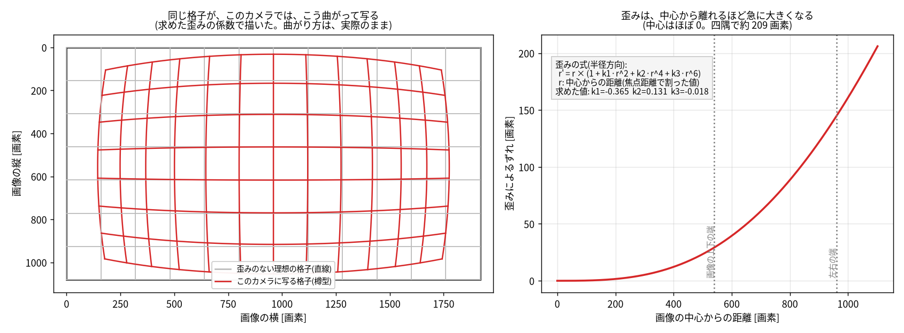
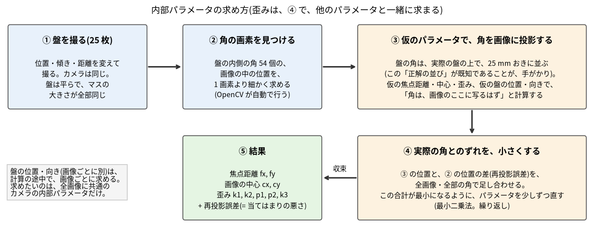
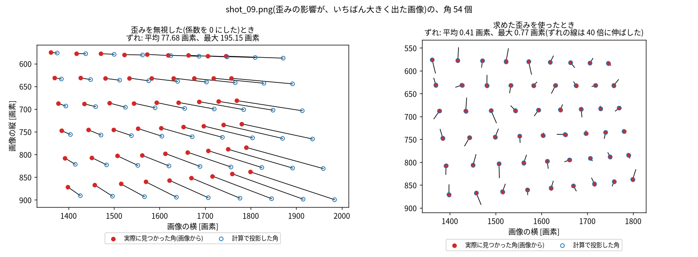
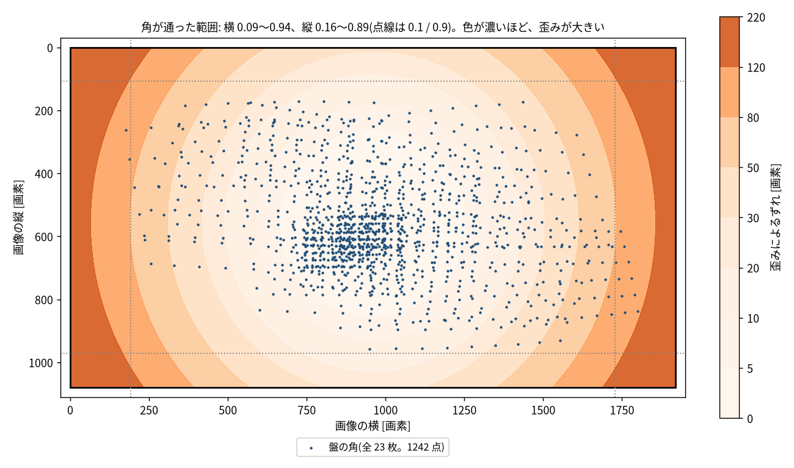
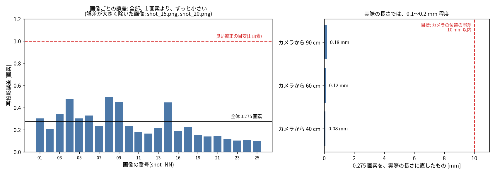
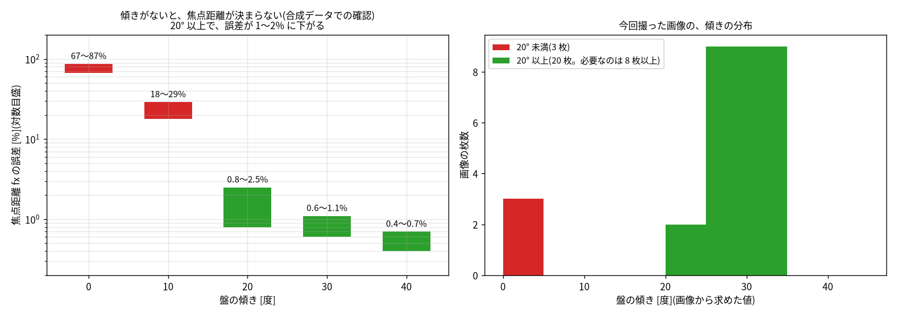

# ウェブカメラの内部パラメータの較正(チェスボード)

実機のウェブカメラ(TUNSONE A03)は、視野角もレンズの歪みも、仕様に書かれていない。広角気味で、画面の端が歪んで見える。
そこで、**チェスボード(白黒の格子)を撮って、カメラの内部の性質を求める**。これは、カメラを机のどこに置いても変わらないので、置き場所の較正(`docs/camera_placement.md`、`docs/marker_placement.md`)の前に、1 回だけ行う。

| 求めるもの | 意味 | 使い道 |
|---|---|---|
| 焦点距離 fx、fy [画素] | 画素と実際の長さの対応。視野角に直せる | sim の `fovy` と同じ値(`pixel_to_world` に使う) |
| 画像の中心 cx、cy | レンズの軸が、画像のどこを通るか | 画素 → 方向の換算 |
| 歪みの係数 k1、k2、p1、p2、k3 | 広角レンズの、樽型の歪み | 補正した画像で、色検出・位置の換算を行う |

## 0. 仕組み(図解)と、実機の結果(2026-10-22)
図は `scripts/make_webcam_calibration_figures.py` で作る(撮った画像から、較正をやり直して描く。画像そのものは載せず、点と線だけ)。

### 0-1. 「歪み」とは何か
広角レンズは、画像の端ほど、写るものを中心へ縮めて写す(樽型の歪み)。歪みのない理想のカメラなら直線に写る線が、曲がって写る。
OpenCV は、この曲がり方を、**中心からの距離 r の式**で表す(半径方向の歪み)。
```
r' = r × (1 + k1·r² + k2·r⁴ + k3·r⁶)        r: 画像の中心からの距離(焦点距離で割った値)
```
k1 が負だと、端ほど縮む(樽型)。このカメラでは k1 = −0.365、k2 = 0.131、k3 = −0.018。ほかに、レンズが少し傾いて付いたことによる歪み(接線方向、p1・p2)もある(このカメラでは、ほぼ 0)。



- 左: 同じ格子が、このカメラでは、赤い線のように曲がって写る(灰色が、理想の直線)。
- 右: **歪みによるずれは、中心ではほぼ 0 で、端ほど急に大きくなる**。画像の四隅では約 209 画素、中心から 1/2 の所では約 21 画素。
  だから、**端の画素を世界の位置に直すとき、歪みを補正しないと、大きくずれる**。補正が要る理由。

### 0-2. 歪みを、どうやって求めるのか
**盤の角は、実際の盤の上で、25 mm おきに、まっすぐ並んでいる。** これが、手がかり。歪みがあれば、画像に写った角の並びは、まっすぐにならない。
そこで、「仮のパラメータで、角を画像に投影したら、実際に見つかった角と、どれだけずれるか」を計算し、**そのずれの合計が最小になるように、パラメータを直す**(最小二乗法)。



- 求めるもの(焦点距離・中心・歪み)は、**全画像に共通**。盤の位置・向きは、画像ごとに違う値で、計算の途中で、一緒に求まる(求めたいのは、内部パラメータだけ)。
- 「ずれ」の大きさ(合計)が、**再投影誤差**。1 画素より小さければ、良い較正。

実際の画像での例(`shot_09.png`。盤が、画像の右の端に寄っていて、歪みの影響が、いちばん大きく出た画像):



- 左: 歪みを無視する(係数を 0 にする)と、計算した角(青い輪)は、実際の角(赤い点)から、平均 78 画素ずれる。
- 右: 求めた歪みを使うと、ずれは、平均 0.41 画素になる(線は、見えるように、40 倍に伸ばした)。ずれの向きは、ばらばらで、一方向に偏ってはいない。これは、角の検出の、ごく小さな誤差が、残っているだけ。

### 0-3. 疑問: 画像の端から端まで、盤が写っていないと、確認できないか
**1 枚の中で、端から端までは要らない。** 必要なのは、**全部の画像を合わせて、画像の端の近くにも、盤の角が通ること**。
歪みのモデルは、中心からの距離の式なので、盤が届かない範囲は、式を延ばして(外挿)推測することになる。



- 青い点が、今回の、全画像の角(23 枚、1242 点)。横は 0.09〜0.94 まで、縦は 0.16〜0.89 まで通った。
- **画像の左右の端は、ほぼ届いた**(歪みが 90 画素ほどの所まで)。**上下の端と、四隅は、届いていない**(色が濃い所に、点が無い)。
- 届いていない所は、式の外挿になる。ただし、高次の係数 k3 は −0.018 と小さく、式が暴れていない。補正した画像の、四隅付近の直線がまっすぐかを、目で確かめる(`outputs/chessboard_undistorted.png`)。
- **まだ確かめていないこと**: 四隅の補正が、何画素の精度かは、測っていない。四隅を使う場合(カメラの視野の端に、立方体が置かれる場合)は、四隅に盤を置いた画像を追加で撮って、較正に使わず、確認用にする(補正後の角が、どれだけまっすぐか)。
  工程 4 では、立方体を、画像の中央付近に置けば、この影響は小さい。

### 0-4. 疑問: 誤差が大きくないか(0.275 画素)
再投影誤差 0.275 画素は、**小さい**。



- 左: 画像ごとの誤差は、0.10〜0.50 画素で、1 画素の目安より、ずっと小さい。誤差が大きかった 2 枚(`shot_15.png`、`shot_20.png`)は、自動で除いた。
- 右: **実際の長さに直すと、0.08〜0.18 mm**(1 画素が表す長さ = 距離 ÷ 焦点距離 1367 画素。カメラから 40 / 60 / 90 cm で、0.29 / 0.44 / 0.66 mm)。工程 3 の目標(カメラの位置の誤差 10 mm 以内)より、2 桁小さい。
- **盤の大きさ(25 mm)の正確さは、あまり要らない**(上の「盤の大きさは、重要か」の節)。盤は、画面に映したもので、平らで、マスは画素どおりの正方形。

**ただし、再投影誤差が小さいことは、パラメータが正しいことの保証ではない**。傾いていない画像だけだと、誤差は小さいまま、焦点距離が大きくずれる。



- 左(合成データでの確認。実測ではない): 傾き 0° だと、焦点距離の誤差が 67〜87%、20° 以上で 1〜2% に下がる。
- 右(今回の実測): 傾き 20° 以上が 20 枚(必要なのは 8 枚以上)。傾きの向きも、右・下・左・上に、偏りなく散っている。
- 今回の結果の焦点距離は、fx = 1367.3、fy = 1368.2 画素(差 0.07%)。正方形の画素なので、矛盾しない。

### 0-5. 今回の結果のまとめ(2026-10-22、TUNSONE A03、1920 × 1080)
| 項目 | 値 |
|---|---|
| 使った画像 | 25 枚中 23 枚(誤差の大きい 2 枚を除いた) |
| 再投影誤差 | 0.275 画素(実際の長さで 0.08〜0.18 mm) |
| 焦点距離 | fx = 1367.3、fy = 1368.2 画素 |
| 画像の中心 | cx = 962.4、cy = 557.1(画像の真ん中は 960、540) |
| 視野角 | 縦 43.1°、横 70.1° |
| 歪み k1、k2、p1、p2、k3 | −0.3647、0.131、−0.0000、−0.0004、−0.018(樽型) |
| 保存先 | `calibration/webcam_intrinsics.json` |

## 1. チェスボード
**作る**: `.venv/bin/python scripts/make_chessboard.py` → `outputs/chessboard_A4.pdf`(と `.png`)。

| 項目 | 値 |
|---|---|
| 用紙 | **A4 を横に**使う(297 × 210 mm) |
| マスの数 | 横 10 × 縦 7 マス(**内側の角は 9 × 6 個**) |
| **1 マスの大きさ** | **25.0 mm**(盤全体は 250 × 175 mm) |
| 印刷 | **「実際のサイズ」「100%」**で。「ページに合わせる」は、大きさが変わるので使わない |

内側の角が、「奇数 × 偶数」(9 × 6)なのは、盤をどちら向きに置いても、向きを見分けられるため。

**なぜ、この大きさか**: カメラの前 60〜90 cm で、1 マスが、画像の 40〜60 画素ほどになり、角を、細かい精度(1 画素より細かい位置)で見つけられる。盤が大きすぎると、画像の端まで動かせず、小さすぎると、角の位置が粗くなる。

### 印刷したあとの確認(大事)
1. ページの下の **100 mm の線**が、定規で 100 mm になっているか確かめる(違えば、倍率を直して、印刷し直す)。
2. 隣り合うマスの幅が 25 mm か、数か所で測る。
3. **平らな固い板に、全面を貼る**(厚さ 3〜5 mm のスチレンボード、アクリル板、MDF など。紙だけだと、波打って、角の位置が狂う)。
4. 艶のない(マットな)紙に印刷する。光沢があると、照明が反射して、角が見つからない。

### 盤の大きさは、重要か(内部パラメータを求めるだけなら、重要ではない)
- 求めるもの(焦点距離・画像の中心・歪み)は、**盤の実際の大きさに、よらない**(合成データで確認: マスの大きさを、25 mm → 40 mm → 18.7 mm と、わざと間違えて較正しても、焦点距離・中心・歪み・視野角は、まったく同じ値になった。変わるのは、盤までの距離の推定だけ)。
- 大事なのは、**マスが全部、同じ大きさの正方形で、盤が平らで、盤全体が、画像に収まる大きさに写る**こと。
- 大きさが効くのは、**盤の位置を、あとで世界の座標(ロボットの座標)に使うとき**(盤を机に固定して、カメラの置き場所を較正する使い方)。そのときは、実際のマスの大きさを、正確に測る必要がある。

### 紙の代わりに、別のパソコンの画面に映してもよいか(よい。条件つき)
盤を手に持つのが面倒なら、**別のパソコンの画面に、チェスボードを映して、それを撮る**ことができる。画面は、完全に平らで、マスが、画素どおりに正確な正方形になるので、むしろ精度が出やすい。
```
.venv/bin/python scripts/make_chessboard.py --screen 1920 1080    # 画面の解像度(幅 高さ)に合わせた PNG を作る → outputs/chessboard_screen_1920x1080.png
```
- **映し方**: 画像を、**全画面で、100%(拡大・縮小なし)**で映す。画面の解像度と、同じ大きさの PNG を作ってあるので、ブラウザ(Firefox など)で開いて F11(全画面)にすれば、ほぼ 100% になる。画面の拡大率(Windows の 125% など)を上げていると、画像がにじむので、100% にする。
- **画面の明るさを、下げる**(目安: 50% 前後)。明るいと、白が飛んで、角が見つからない。カメラは、`--manual` で露出を固定する(画面は自分で光っているので、自動露出だと、明るすぎる)。
- **反射を避ける**: 画面に、照明や窓が映り込まないようにする。艶のある画面は、反射しやすい。
- **ちらつき(縞模様)**: 画面とカメラの、明るさの更新の周期が重なって、縞が出ることがある。露出は 10 ミリ秒以上(`--exposure 100` 以上)にして、縞が出たら、露出を変える。**画面のドットの細かい格子と、カメラの画素の格子が重なって、モアレ(波模様)が出る**こともある。距離や角度を少し変えると、消える。
- **動かし方が、紙と違う**: 画面は、持って動かせない。**盤の位置・傾きは、「カメラのほうを動かす」**ことで作る(画面は、机に置いたまま)。
  - 画面の四隅・真ん中: カメラを、**手で持って、画面のほうを向けたまま、左右・上下に振る**(画面が、画像の四隅に来る)。
  - 傾けた画像: カメラを、画面の左右・上下に、回り込ませる。または、ノートパソコンの画面を、傾ける。
  - 遠く・近く: カメラを、画面から離す・近づける。
  - 内部パラメータは、カメラの置き場所によらないので、カメラを動かしても、問題ない。
- **画面の傾けすぎに注意**: 液晶は、斜めから見ると、明るさ・コントラストが落ちる。40° までにする。
- **画面を、カメラの視線に対して、30° 以上傾ける(必須)。** 画面は 1 枚の平面なので、**カメラも画面も動かさず、盤を画面の中で動かすだけでは、較正が成り立たない**(画面がカメラに正対していると、焦点距離が、数倍に狂った)。合成データでの結果(焦点距離 1100 画素、盤を画面上で 40 通りに動かして、fx の誤差。6 回の平均): 傾き 0° で 67〜87%、10° で 18〜29%、20° で 0.8〜2.5%、**30° で 0.6〜1.1%**、**40° で 0.4〜0.7%**。盤の面内の回転は、ほとんど効かない。
  **遠近法で傾けた盤を、画面に描く方法は、効果がない**(合成データで確認。画面がカメラに正対していると、アプリで 30°・45° に傾けて描いても、fx の誤差は 56〜120%。盤は、画面の平面の上にあり、カメラから見た平面の向きは、1 つのままで、焦点距離を決める手がかりが増えない。正方形の格子として渡すと、データがモデルと合わず、再投影誤差も増える)。傾きは、画面を物理的に傾けて作る。
- 画面は、カメラから 50 cm で、画像の幅の 1/3 ほどしか占めない(15.6 型)。**画像の隅に盤を映すには、画面そのものを、画像の隅へ動かす必要がある**(外付けの大きなモニターを近くに置くと、動かさずに済むが、近づけすぎるとぼける)。
- 画面の大きさ(盤の物理的な大きさ)は、画面ごとに違うが、上のとおり、内部パラメータには、影響しない。

### どこに置くか(使い方)
**ロボットアームの土台の上に、固定するものではありません。** この較正では、盤を**手に持って**、カメラの前で、色々な位置・傾きに動かして、何枚も撮る(歪みは、画像の端ほど大きいので、端まで盤を動かす)。
(のちに、カメラの置き場所の較正で、**盤を机の上に、位置を決めて固定する**使い方もある。それは別の作業で、同じ盤を使える。)

## 2. 撮る
**撮る前に、明るさを確かめる**(白と黒がつぶれない明るさに)。
```
.venv/bin/python scripts/check_webcam.py --manual --exposure 300 --gain 32     # 「明るさ 平均」が 100〜150 くらいが目安(この部屋では、300 で 103)
```
暗ければ `--exposure` を大きく(1000 で 174、2000 で 207)、明るすぎれば小さくする。決まった値を、下の撮影にも同じに渡す。
**試しに 1 枚撮る**(Enter キーで撮る。盤の持ち方・明るさ・反射を確かめる。**毎回、`outputs/chessboard_test.png` に上書きされ、較正用の保存先 `outputs/chessboard_shots/` には保存されない。較正には使われない**):
```
.venv/bin/python scripts/capture_chessboard.py --test --manual --exposure 300
```
Enter を押すたびに 1 枚撮り、「角が見つかったか」「明るさ」「くっきり度(小さいと、ぼけ・ぶれ)」「盤の幅が、画像の幅の何割か」を表示する。画像は `outputs/chessboard_test.png` に上書き保存される。q + Enter で終わる。

**本番**(撮り方は 2 通り):
```
.venv/bin/python scripts/capture_chessboard.py --enter --manual --exposure 300   # Enter キーを押すたびに撮る(自分のペースで、20 枚)
.venv/bin/python scripts/capture_chessboard.py --manual --exposure 300            # 8 秒ごとに、自動で撮る(両手で盤を持つとき)
```
`--enter` は、**前の実行で撮った画像の、続きの番号**(shot_07.png の次は shot_08.png)から保存する。何回かに分けて撮っても、上書きされない。やり直したいときは、`outputs/chessboard_shots/` の画像を、自分で消す。
画面に映した盤を撮る場合は、`--plan outputs/chessboard_app/shooting_plan.txt` を付けると、ターミナルの指示が、その計画(近い距離 12 枚、中くらい 6 枚、遠い 4 枚。傾きと盤の配置)の順に出る(内蔵の指示は、紙の盤を手で動かす場合のもの)。
(露出を固定した後、自動に戻すには: `v4l2-ctl -d /dev/video2 -c auto_exposure=3,white_balance_automatic=1`)
```
.venv/bin/python scripts/capture_chessboard.py --manual --exposure 300        # 20 枚、8 秒おき。露出と色を固定する
.venv/bin/python scripts/capture_chessboard.py --shots 25 --interval 6
```
- ターミナルに、「次: 画像の左上の隅に近づけて」のように、**盤を動かす位置の指示**が出る。指示どおりに動かして、次の撮影まで、止める。
- 角が見つかったものだけが、`outputs/chessboard_shots/` に保存される(`outputs/` は git に入らない。部屋が写った画像が、記録に残らない)。
- 撮る条件: 盤が全部、画像の中に入る。ぶれない(動かしたら、止めてから撮る)。照明が、盤に反射しない。盤を、画像の**端いっぱい**までと、**遠く・近く**、**傾けた向き**の、いろいろで撮る。

### 撮影の計画(20 枚の例)
**角度を細かく刻む必要はない**(2° ずつずらした画像は、ほとんど同じで、情報が増えない)。**位置・傾きの向き・距離が、はっきり違う画像**を、1 枚ずつ撮る。傾きは、目分量で「だいたい 30° くらい」でよい(正確な角度は、較正が自分で求める)。

| 種類 | 枚数 | 盤の置き方 |
|---|---|---|
| 正面向き(傾けない) | 5 | 画像の**真ん中**と、**四隅**(左上・右上・左下・右下)。歪みは、画像の端ほど大きいので、角を使う。横にずらすだけだと、上下の端が撮れない |
| 左右に傾ける | 4 | 画像の左側で、右へ 30° 傾ける / 右側で、左へ 30° 傾ける / 真ん中で、左へ 25° / 真ん中で、右へ 25° |
| 上下に傾ける | 4 | 画像の上側で、手前へ 30° / 下側で、奥へ 30° / 真ん中で、手前へ 25° / 真ん中で、奥へ 25° |
| 斜めに傾ける | 3 | 左上で右下へ 35°、右下で左上へ 35°、真ん中で、右上がりに 30° |
| 遠く・近く | 4 | 遠く(画像の 1/4 くらいの大きさ)に、正面向きと傾き 30° を 1 枚ずつ。近く(画像の半分くらいの大きさ)に、正面向きと傾き 30° を 1 枚ずつ |

(`capture_chessboard.py --enter` の指示も、この順に近いもの。)

### カメラと盤の置き方
- **カメラは、動かないように置く**(机や三脚に。向きは、どちらでもよい。較正で求めるのは、カメラの内部の性質で、置き場所には関係しない)。解像度は、実際に使う 1920 × 1080 のまま。
- **盤を、手に持つ。** 両手で、盤の**縁だけ**を持ち、角を指で隠さない。盤は、平らな板に貼ったもの。
- **盤を、レンズに「平行」にする必要は、ありません。むしろ、傾けた画像が、必要です。** 正面向き(平行)の画像だけだと、焦点距離と、盤までの距離を、見分けられず、較正が決まらない。
  - 正面向きに近い画像: 5 枚ほど(画像の端の、歪みを見るため。端いっぱいに動かす)。
  - **傾けた画像: 10 枚以上。傾きは、左右・上下に、20〜40° くらい。** 角度がついて、いろいろな向きがあるほど、良い。
  - 傾けすぎ(50〜60° 以上)は、盤の格子が、細く潰れて、角が見つからない。避ける。
- 距離は、カメラから 40〜90 cm。遠い・近いの両方を入れる(盤が、画像の 1/4〜1/2 を占めるくらい)。

## 3. 求める
```
.venv/bin/python scripts/calibrate_webcam_intrinsics.py
```
結果は `calibration/webcam_intrinsics.json` に保存される(画像は含まない。git に入れてよい)。見るもの:
- **再投影誤差**: 1 画素未満なら、良い。大きいときは、盤が反っている、ぶれている、枚数が少ない、のどれかを疑う。
- **角が通った範囲**: 画像の端(0.1 より外側と、0.9 より外側)まで、角が通ったか。通っていないと、端の補正が当てにならない。
- **補正の前後の画像**(`outputs/chessboard_undistorted.png`): 補正後に、盤の線が、まっすぐになっているか。
- fx と fy が、1% 以内で同じか。

## 4. 確認(合成データ)
`scripts/check_intrinsics.py`(全 OK): 焦点距離・歪みを決めた、仮のカメラで、盤を色々な位置に置いた角の画素を、計算で作り(ノイズ 0.3 画素)、較正が、本当の値を取り戻すか。20 枚で、焦点距離の誤差 0.2% 程度、k1 の誤差 0.002 程度。
実機の精度の目安になる(実機では、角の検出誤差や、盤の反りが、これに加わる)。

## 5. このあと
1. 求めた内部パラメータで、カメラ画像の歪みを補正する(`cv2.undistort`)。
2. 補正した画像で、色検出と、画素 → 世界座標の換算(`pixel_to_world`、`camera_pose.py`)を行う。視野角は、求めた値を使う(`fix_fovy=True` で、較正の安定性が増す)。
3. カメラの置き場所の較正(固定の目印の板、手の目印)を、実機で行う。
